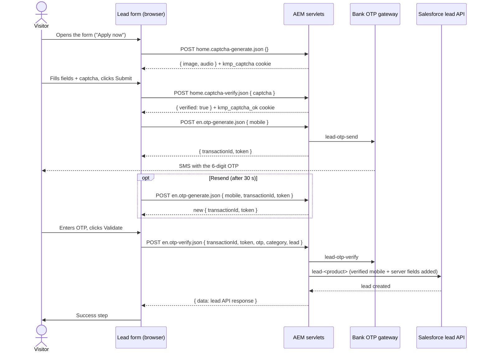

# Lead Form - How the Flow Works

This document describes the lead form ("Start Your Loan Journey Today") from the moment it opens to the moment a lead
is created in Salesforce: which files do what, which requests are sent, what each request contains, and how errors are
handled.

Backend side (OSGi configs, API profiles, secrets): see `OSGI-CONFIGURATION.md` and `ENVIRONMENT-VARIABLES.md` in the
AEM backend repository.

---

## 1. Files

| File | Responsibility |
|---|---|
| `lead-api-config.js` | **The only file to edit** when endpoints, products, field names or messages change. Endpoints, category -> product map, lead field keys per product, city sheets, timeouts, visitor messages. |
| `lead-form.js` | Builds the form from the authored block, validation, captcha field, city dropdown, submit handler, success step, analytics events, prefill from other forms. |
| `lead-form-otp.js` | The OTP step: six digit boxes, Validate button, 30 s resend countdown, wrong / expired OTP states. |
| `lead-api.js` | All network calls: `generateCaptcha`, `createLeadSession` (captcha verify -> OTP send/resend -> OTP verify), error -> visitor message (`errorMessage`). |
| `lead-payload.js` | Turns the filled form into the `lead` object for the chosen product (`buildLead`), and the loan category into the backend product (`productFor`). |

Everything in these files is shipped to the browser. **No API keys, secrets or passwords belong here**; the backend
adds all credentials and server-owned fields.

---

## 2. Endpoints

All four are AEM servlets on the AEM publish tier, called with `POST`, JSON body, `credentials: 'same-origin'`.

| Key in `ENDPOINTS` | Path |
|---|---|
| `captchaGenerate` | `/content/kotakmahindraprime-aem/in/en/home.captcha-generate.json` |
| `captchaVerify` | `/content/kotakmahindraprime-aem/in/en/home.captcha-verify.json` |
| `otpGenerate` | `/content/kotakmahindraprime-aem/in/en.otp-generate.json` |
| `otpVerify` | `/content/kotakmahindraprime-aem/in/en.otp-verify.json` |

**No host, never localhost.** The paths start at `/content`, so the browser sends them to the domain the page is served
from. Locally in Postman they are tested against `http://localhost:5502`; in the browser they go to the site's own
domain, which must route `/content/kotakmahindraprime-aem/...` to AEM publish.

**Cookies.** The captcha state lives in HttpOnly cookies (`kmp_captcha`, `kmp_captcha_ok`) set by the captcha calls and
read by `otp-generate`. They only travel on the same domain. The captcha calls are under `.../in/en/home` and the OTP
calls under `.../in/en`, so the backend must set those cookies with a `Path` that covers both (e.g. `Path=/`). Without
it the browser does not send `kmp_captcha_ok` to `otp-generate`, and it answers `CAPTCHA_REQUIRED`.

**Every response** has the shape:

```json
{ "status": "success", "data": { ... } }
{ "status": "error", "code": "INVALID_OTP", "message": "Incorrect OTP. 2 attempts left." }
```

Anything other than `status: "success"` with HTTP 2xx is treated as a failure (see section 7).

---

## 3. Flow at a glance



---

## 4. Step by step

### 4.1 Opening the form

1. The block is decorated (`decorate` in `lead-form.js`): fields are built from the authored items, the disclaimer and
   button are added.
2. **Loan category** is preselected from the page: the hero's category dropdown on product pages, else the page
   metadata `loan-category`.
3. **City dropdown** is filled from the city sheet of the category's API (`CITY_LISTS`):

   | Product | Sheet | Column |
   |---|---|---|
   | `LAP` | `/lap-cities.json` | `SUB_CITY_NAME` |
   | `NewCarFinance` | `/ncf-cities.json` | `SUB_CITY_NAME` |
   | `TWL` | `/tw-cities.json` | `SUB_CITY_NAME` |
   | `CarLease`, `DealerFinance` | `/ncf-cities.json` (for now) | `SUB_CITY_NAME` |

   A category without a sheet keeps the authored options. Changing the category reloads the list.
4. **Captcha** is requested (`generateCaptcha`):
   - Request: `POST home.captcha-generate.json` with `{}`
   - Response `data`: `{ image, audio }`, Base64 (data URI or bare). `audio` is optional; without it the listen button
     is hidden.
   - Sets the `kmp_captcha` cookie. A new captcha is loaded on every opening and on the refresh button.

### 4.2 Submit: captcha, then OTP

When the visitor clicks Submit and every field is valid, `lead-form.js` creates a **lead session**
(`createLeadSession`) for this one submission:

```js
createLeadSession({
  mobile,                              // from the tel input
  product: productFor(category),       // 'LAP' | 'NewCarFinance' | 'TWL' | ''
  lead: buildLead(form, category),     // see section 5
  loanCategory: category,              // for analytics only
});
```

`session.submit(captcha)` then runs two calls in order:

1. **Verify captcha**
   - Request: `POST home.captcha-verify.json` `{ "captcha": "aB3dE" }` (case-sensitive, one attempt per captcha)
   - Response `data`: `{ verified: true }`, sets `kmp_captcha_ok`
   - `verified: false` is treated as `INVALID_CAPTCHA`.
2. **Send OTP**
   - Request: `POST en.otp-generate.json`
     ```json
     { "mobile": "98XXXXXXXX" }
     ```
   - Response `data`: `{ "transactionId": "TXN...", "token": "..." }`
   - The mobile must be 10 digits starting with 6-9, checked before sending.

On failure the error is shown above the button and a **new captcha is loaded** (the old one is used up). On success the
OTP step is shown.

### 4.3 OTP step

`createOtpStep` in `lead-form-otp.js`:

- Six digit boxes, Validate button, a message under the title with the masked number (`******1234`).
- **Resend** is available after a 30 s countdown (`RESEND_SECONDS`). It calls `session.sendOtp()` again, which now
  sends the latest pair:
  ```json
  { "mobile": "98XXXXXXXX", "transactionId": "TXN...", "token": "..." }
  ```
  The answer's new pair replaces the old one (each token is good for one resend). No captcha is needed for a resend; the
  token proves it.
- **Back** returns to the form with values kept; a new captcha is loaded, because a new OTP needs a new captcha.
- Closing the modal stops the countdown and cancels any request still running.

#### Messages, resend limit and wrong-OTP lock

The backend does not limit resends or block after wrong OTPs, so the frontend does (`MAX_RESENDS`, `MAX_WRONG_OTPS`
in `lead-api-config.js`; the texts are in `MESSAGES`). Counts are per OTP screen (Back starts a new one with fresh
counts); wrong OTPs keep counting across resends. Nothing is stored in the browser.

| When | Top message (under the title) | Under the boxes |
|---|---|---|
| OTP screen opens | `otpSent`: "Please enter the OTP that was sent to your mobile number ******9244" | - |
| Resend 1 and 2 | `otpResent`: "Please enter the OTP which was re-sent to your mobile number ******9244." | - |
| Resend 3 | `otpResentLast`: "... re-sent to your mobile number ******9244. Please note this is your last attempt to resend the OTP." | - |
| Resend click 4 (no request sent), or `RESEND_LIMIT` from the API | `resendExhausted` **in red**; Resend link hidden; boxes greyed and disabled | nothing (the API's message is not shown) |
| Wrong OTP 1 | unchanged | `wrongOtpAttemptsLeft`: "... You have 2 attempts remaining ..." |
| Wrong OTP 2 | unchanged | `wrongOtpAttemptsLeft`: "... You have 1 attempts remaining ..." |
| Wrong OTP 3 | unchanged; boxes greyed and disabled, Validate off, Resend still shown | `otpLocked`: "You have exceeded maximum number of attempts to generate OTP. Please try again after 30 Minutes." |
| Resend after wrong OTP 3 (no request sent) | unchanged; Resend link stays and looks the same, but further taps do nothing | `resendExhausted` replaces `otpLocked` |
| Validate answered with a message mentioning expiry ("Invalid or expired OTP.") | unchanged | `OTP_EXPIRED`: "OTP expired. Please regenerate." (not counted as a wrong OTP) |
| Send OTP (form) or Resend fails without a more specific message | - | `sendFailed`: same text as `resendExhausted` (above the Apply button on the form, under the boxes on the OTP screen) |

A wrong OTP is `INVALID_OTP`, `OTP_ATTEMPTS_EXCEEDED` or a refusal without a code; an expired OTP, a server or network
error does not count.

### 4.4 Validate OTP and create the lead

`session.verifyOtp(otp)`:

- Request: `POST en.otp-verify.json`
  ```json
  {
    "transactionId": "TXN...",
    "token": "...",
    "otp": "123456",
    "category": "NewCarFinance",
    "lead": { "FirstName": "...", "LastName": "...", "Email": "...", "Pincode": "...", "Location": "...", "Product": "New Car Finance" }
  }
  ```
- The backend verifies the OTP, picks the lead API from `category`, adds the **verified mobile** and its own fields, and
  calls Salesforce. It answers `success` only when the lead was really created; otherwise HTTP 502 `LEAD_FAILED`.
- Response `data` is the lead API's own answer. The lead id is read from `LeadId` / `LeadNumber` (LAP, TWL) or the
  `referLead` part of the Salesforce composite response (NewCarFinance).
- After success the `transactionId` and `token` are wiped, so the same OTP is never sent twice, and Validate stays
  disabled.

### 4.5 Success

`finish` in `lead-form.js`:

1. Pushes the `generate_lead` analytics event (with `lead_id`, never personal data).
2. Sets `window.kmpLead = { leadId, category, loanCategory, createdAt }` and dispatches `kmp:lead-created` on
   `document` (`LEAD_RESULT_KEY`, `LEAD_CREATED_EVENT`).
3. Clears the form and shows the success step (with a link to the EMI calculator).

---

## 5. What is sent per product

### 5.1 Loan category -> product (`PRODUCT_BY_CATEGORY`)

| Loan category in the form | `category` sent | Extra `lead` field |
|---|---|---|
| New Car Finance | `NewCarFinance` | `Product: "New Car Finance"` |
| Used Car & Re-finance | `NewCarFinance` | `Product: "Used Car"` |
| Top-Up Loan | `NewCarFinance` | `Product: "PL/KPTR"` |
| Two-Wheeler Loan | `TWL` | - |
| Loan Against Property | `LAP` | - |
| Car Lease | `CarLease` | - |
| Dealer Finance | `DealerFinance` | - |

Matching ignores case, spaces and punctuation ("Two-Wheeler Loans" = "two wheeler loan").

### 5.2 Form field -> lead key (`LEAD_KEYS_BY_PRODUCT`)

The form is first read into common names (`FirstName`, `LastName`, `Email`, `Location` from City, `Pincode` from
Zip / Postal code). Then only the keys the product's API takes are kept, renamed for that API. Blank fields are left
out.

| Form value | LAP | NewCarFinance | TWL |
|---|---|---|---|
| First name | `FirstName` | `FirstName` | `firstName` |
| Last name | `LastName` | `LastName` | `lastName` |
| Email | `Email` | `Email` | `email` |
| City | `Location` | `Location` | `businessLocation` |
| Zip / Postal code | - | `Pincode` | - |
| Product (from 5.1) | - | `Product` | - |

**Name fields:** a form with "First name" + "Last name" sends them as they are; a form with one "Your name" field is
split at the first space ("Asha Rao Kulkarni" -> `FirstName: "Asha"`, `LastName: "Rao Kulkarni"`).

**Never sent in `lead`:** the mobile number (the backend adds the OTP-verified one), the captcha.

### 5.3 Example `otp-verify` bodies

**Loan Against Property**
```json
{
  "transactionId": "TXN...", "token": "...", "otp": "123456",
  "category": "LAP",
  "lead": { "FirstName": "Test", "LastName": "User", "Email": "test@example.com", "Location": "Mumbai" }
}
```

**New Car Finance**
```json
{
  "transactionId": "TXN...", "token": "...", "otp": "123456",
  "category": "NewCarFinance",
  "lead": {
    "FirstName": "Test", "LastName": "User", "Location": "Mumbai", "Pincode": "400067",
    "Email": "test@example.com", "Product": "New Car Finance"
  }
}
```

**Two-Wheeler Loan**
```json
{
  "transactionId": "TXN...", "token": "...", "otp": "123456",
  "category": "TWL",
  "lead": { "firstName": "Test", "lastName": "User", "businessLocation": "Mumbai", "email": "test@example.com" }
}
```

### 5.4 What the backend adds (not sent by the browser)

| Category | Added by the backend |
|---|---|
| `LAP` | `Phone` = verified mobile (number), `LeadSource`, `EnquiryType` |
| `TWL` | `mobileNumber` = verified mobile, `product`, `loanType`, `subSource`, `leadSource`, `portfolio`, `stage`, `status`, `salutation`, `middleName` defaults |
| `NewCarFinance` | Whole Salesforce composite request built from the `newcarfinance` template; `{{mobile}}` = verified mobile |

A different mobile in the form than the verified one is refused by the backend (`MOBILE_MISMATCH`).

### 5.5 Categories without an API

A category not listed in `PRODUCT_BY_CATEGORY` has no API: `category` is sent empty and every form field is sent under its own name. The backend stores the submission in S3. On
the frontend these categories are **lenient**: whatever the OTP or verify call answers, the visitor reaches the success
step (a warning is logged in the console). Remove this once they have a lead API: add a line to
`PRODUCT_BY_CATEGORY` and `LEAD_KEYS_BY_PRODUCT`; no other code change is needed.

---

## 6. Security of the OTP journey

- `transactionId` and `token` exist **only in the session's closure** in `lead-api.js`: never on `window`, in
  localStorage/sessionStorage, cookies, the DOM, the URL or the console.
- They are sent only to `otp-generate` (on resend) and `otp-verify`, and wiped on cancel, on closing the modal and once
  a lead is created.
- Each submit gets its own session, so another form's journey is never reused.
- Double clicks never send two requests (`singleFlight`).
- Every request is cancelled after 15 s (`REQUEST_TIMEOUT_MS`) and shown as a timeout.
- Analytics never receive personal data (no name, mobile, email or OTP); the city is the only form value tracked.

---

## 7. Errors

`lead-api.js` turns every failure into a `LeadApiError` with a `kind`:

| `kind` | Meaning |
|---|---|
| `invalid-input` | Bad mobile/OTP, nothing was sent |
| `timeout` | No answer within 15 s |
| `network` | Offline, DNS, CORS... |
| `cancelled` | Visitor left the step (nothing is shown) |
| `http` | Error status from the server (`status`, `code`) |
| `bad-response` | Not the expected JSON (e.g. an HTML page because the selector was not matched) |
| `rejected` | `status` is not `success` (e.g. wrong OTP) |

`errorMessage(error, action)` picks the visitor text in this order:

1. Captcha load failure -> `captchaLoadFailed`.
2. Codes whose server message is written for visitors (`SERVER_MESSAGE_CODES`: `INVALID_OTP`,
   `OTP_ATTEMPTS_EXCEEDED`, `RESEND_TOO_SOON`, `RESEND_LIMIT`, `BAD_REQUEST`, `OTP_SEND_FAILED`, `OTP_VERIFY_FAILED`,
   `LEAD_FAILED`) -> the server's `message` as is.
3. Expired OTP (code, message, or refused more than 5 minutes after sending) -> `OTP_EXPIRED`.
4. A code listed in `MESSAGES` -> that text.
5. Timeout / network -> their texts; otherwise a generic send/submit failure.

What the OTP step does with specific codes:

| Code | Behaviour |
|---|---|
| `CAPTCHA_REQUIRED` | Session or token expired: back to the form, new captcha, message at the captcha |
| `INVALID_OTP` | Digits cleared, counted as a wrong OTP (see 4.3 for the messages) |
| `OTP_ATTEMPTS_EXCEEDED` | Digits cleared, counted as a wrong OTP, Validate blocked until a resend |
| `RESEND_TOO_SOON` | Countdown restarted |
| `RESEND_LIMIT` | Resend link hidden, `resendExhausted` in red at the top (the API's message is not shown) |

Backend limits (from `OtpServiceImpl`): OTP valid 300 s, 3 resends per captcha, 30 s between resends, 3 verify
attempts per OTP.

---

## 8. Common changes

| Change | Where |
|---|---|
| Endpoint path | `ENDPOINTS` in `lead-api-config.js` |
| New loan category with an API | `PRODUCT_BY_CATEGORY` (+ `LEAD_KEYS_BY_PRODUCT` and `CITY_LISTS` if it is a new product) |
| API field name changed | `LEAD_KEYS_BY_PRODUCT` |
| New form field | Author it in the block; it is read automatically. Add it to the product's `LEAD_KEYS_BY_PRODUCT` entry to send it |
| Visitor message | `MESSAGES` |
| Resend limit, wrong-OTP limit | `MAX_RESENDS`, `MAX_WRONG_OTPS` |
| OTP length, resend wait, timeout | `OTP_LENGTH`, `RESEND_SECONDS`, `REQUEST_TIMEOUT_MS` (keep in line with the backend) |

## 9. Testing checklist

1. Serve the page from a domain that routes `/content/kotakmahindraprime-aem/...` to AEM publish (not
   `localhost:3000`, which has no servlets).
2. DevTools -> Network:
   - `home.captcha-verify.json` answer has `Set-Cookie: kmp_captcha_ok=...; Path=/` (or a path covering
     `/content/kotakmahindraprime-aem/in/en.otp-generate.json`).
   - `en.otp-generate.json` request body is `{ "mobile": "..." }` and the cookie is sent.
   - `en.otp-verify.json` request body matches section 5.3 for the chosen category.
3. Try each category: New Car Finance, Used Car & Re-finance, Top-Up Loan, Two-Wheeler Loan, Loan Against Property.
4. Try a wrong OTP, a resend, closing the modal mid-journey, and an OTP older than 5 minutes.
5. After success: `window.kmpLead` holds the lead id, and the `generate_lead` event is in the data layer.
